# UX Flows: Automated Delivery Marketplace

| Field | Value |
|---|---|
| Status | v0.2 — product-owner approved as input for Phase 0 and provider-free Phase 1; specialist reviews pending |
| Product name | To be determined |
| Pilot | Immediate local delivery within the City of Montreal |
| Source of truth | `docs/product/PRD.md`, v0.3 |
| Last updated | 2026-10-28 |
| Next artifact | Technical Design Document (TDD) |

## 1. Purpose

This document translates the PRD into user-visible journeys, screens, decisions, system responses, and failure states. It defines **how the product behaves from the user's point of view** without selecting frameworks, database structures, vendors, or implementation architecture.

The flows are the design input to wireframes and the behavioral input to the TDD. Every core flow traces back to numbered PRD requirements.

## 2. Experience principles

1. **One next action:** Each state should make the user's next permitted action obvious.
2. **Truthful status:** Never display success, live tracking, payment, or assignment as complete when the system outcome is unknown.
3. **Explain before commitment:** Show price, driver payout, expiry, cancellation consequence, and permissions before confirmation.
4. **No routine human dispatch:** Automated matching owns the normal path; support handles exceptions only.
5. **Safe failure:** Payment, location, camera, network, and matching failures must preserve a recoverable state.
6. **Privacy by state:** Show precise location and personal information only when the current delivery relationship permits it.
7. **Bilingual core journey:** Core sender, driver, payment, safety, and support experiences are available in French and English.
8. **Mobile-first driver experience:** Driver actions must remain practical on a mobile-sized screen and while stopped safely.
9. **Accessible communication:** Status must use text and structure, not color alone; core flows support keyboard and assistive technology.

## 3. Actors

| Actor | Objective | Key permissions |
|---|---|---|
| Sender | Request, pay for, monitor, and confirm a delivery | Create own requests; see assigned driver and permitted tracking; cancel under policy; view proof; report issues |
| Driver | Receive suitable offers and complete accepted deliveries | Manage own profile and availability; accept one active offer; update assigned delivery; share location; upload proof; see earnings |
| Platform | Match the two sides and enforce product rules | Validate; quote; authorize; rank; offer; assign; notify; record; calculate fees and payout |
| Support / risk administrator | Resolve exceptions without brokering routine jobs | Inspect authorized account, delivery, payment, proof, and audit information; apply approved exception procedures |

## 4. Core experience map

```mermaid
flowchart LR
    S1["Sender creates immediate request"] --> S2["Platform validates parcel and Montreal route"]
    S2 --> S3["Platform presents 10-minute quote"]
    S3 --> S4["Sender authorizes payment and publishes"]
    S4 --> M1["Platform filters and ranks eligible drivers"]
    M1 --> D1["Driver receives 60-second offer"]
    D1 -->|Accept| A1["Driver assigned"]
    D1 -->|Decline or expire| M1
    M1 -->|No candidate remains| U1["Request unfulfilled; authorization voided"]
    A1 --> P1["Driver reaches pickup"]
    P1 --> P2["Pickup code verified; payment captured"]
    P2 --> T1["Live delivery tracking"]
    T1 --> C1["Driver uploads delivery photo"]
    C1 --> C2["Delivery completed"]
    C2 --> C3["Sender sees proof and may rate or report issue"]
    C3 --> E1["Driver earnings clear after 24-hour issue window"]
    E1 --> E2["Weekly bank payout"]
```

## 5. Navigation and screen inventory

Screen IDs are stable references for wireframes, user stories, analytics, and the TDD. They are not route names or implementation requirements.

### 5.1 Shared screens

| ID | Screen or state | Primary purpose |
|---|---|---|
| SH-01 | Language selection | Select French or English; allow later change |
| SH-02 | Sign up / sign in | Authenticate and recover access |
| SH-03 | Role entry | Continue as sender or enter driver onboarding |
| SH-04 | Notifications center | Show operational events with read state and delivery link |
| SH-05 | Help and safety | Explain support options, issue types, and emergency guidance |
| SH-06 | Account and privacy | Manage profile, language, permissions, and account requests |

### 5.2 Sender screens

| ID | Screen or state | Primary purpose |
|---|---|---|
| SE-01 | Sender home | Start a delivery and see active or recent deliveries |
| SE-02 | Pickup and destination | Enter and validate Montreal addresses and contacts |
| SE-03 | Parcel details | Enter category, description, dimensions, weight, declared value, and handling notes |
| SE-04 | Quote review | Review route summary, price breakdown, expiry, restrictions, and cancellation summary |
| SE-05 | Payment authorization | Choose card or eligible verified bank account and authorize total |
| SE-06 | Matching | Show matching progress, quote validity, cancellation option, and truthful elapsed state |
| SE-07 | Driver assigned | Show driver and vehicle details permitted by policy, ETA, and delivery status |
| SE-08 | Active tracking | Show current status, map or stale state, update time, ETA when available, and help |
| SE-09 | Delivery completed | Show delivery photo, completion details, receipt, rating, and issue-report entry |
| SE-10 | Delivery history/detail | Show status history, financial summary, proof, and support record |
| SE-11 | Sender cancellation review | Explain charge and effect before cancellation confirmation |
| SE-12 | No driver available | Explain unfulfilled outcome, payment void, retry, and edit options |

### 5.3 Driver screens

| ID | Screen or state | Primary purpose |
|---|---|---|
| DR-01 | Driver onboarding | Collect identity, licence, vehicle, insurance, payout, consent, and agreements |
| DR-02 | Verification status | Show missing, pending, approved, rejected, or expired items |
| DR-03 | Driver home / availability | Go available or unavailable and see current assignment and earnings summary |
| DR-04 | Delivery offer | Show countdown, delivery details, guaranteed payout, and accept or decline |
| DR-05 | Accepted delivery | Show pickup details, safe navigation handoff, parcel information, and cancellation/help |
| DR-06 | Pickup confirmation | Enter one-time code; handle payment capture or code failure before handoff |
| DR-07 | Active delivery | Show destination, current state, tracking permission, contact/help, and arrival action |
| DR-08 | Proof of delivery | Capture or upload photo, review privacy reminder, and submit completion |
| DR-09 | Failed delivery | Record contact attempts, wait timer, reason, and approved next action |
| DR-10 | Earnings and payouts | Show pending, cleared, paid, adjusted, and failed balances with statements |
| DR-11 | Driver cancellation review | Explain rematching, reliability effect, safety reason, and confirmation |

### 5.4 Support screens

| ID | Screen or state | Primary purpose |
|---|---|---|
| SU-01 | Delivery lookup | Find a delivery using authorized identifiers without exposing unrelated data |
| SU-02 | Delivery timeline | Inspect offers, assignment, status, location freshness, proof, payment, and audit history |
| SU-03 | Issue case | Classify, assign, document, and resolve an incident under approved procedures |
| SU-04 | Account review | Inspect verification and standing; suspend or reinstate only with an auditable reason |
| SU-05 | Payment / payout exception | Inspect authorization, capture, refund, adjustment, and payout failure states |

## 6. UF-01 — Account, role, and language

**Goal:** Let a user authenticate, choose a language, and enter the correct sender or driver journey.

**PRD trace:** FR-001, FR-035.

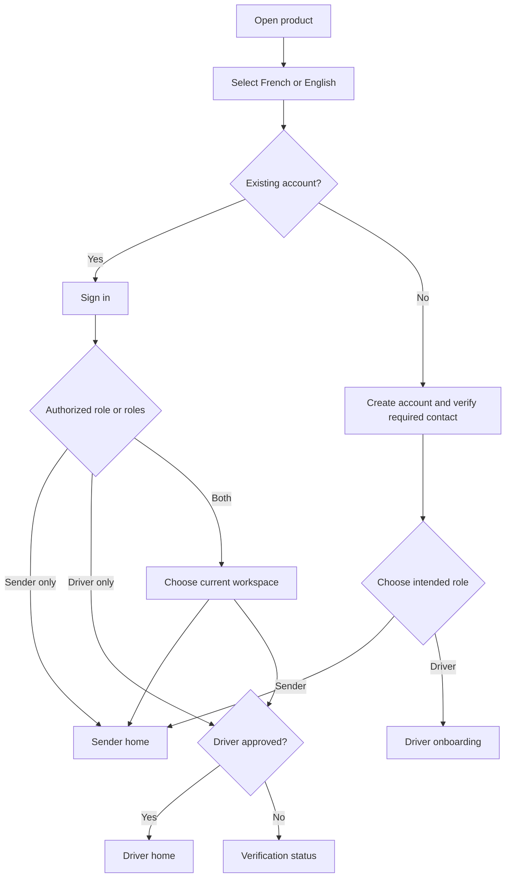

### Required states

- Invalid or expired credentials
- Contact verification pending
- Account suspended, with safe next step
- Driver documents missing, pending, rejected, or expired
- Language switch preserves current safe progress when possible
- Sender access does not require driver verification

## 7. UF-02 — Driver onboarding and verification

**Goal:** Admit only drivers who meet the approved identity, vehicle, insurance, payout, and consent rules.

**PRD trace:** FR-006, FR-007, FR-035; PRD 8.6.

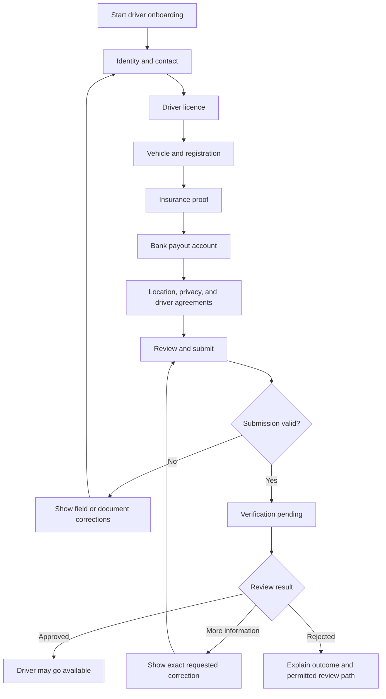

### UX rules

- Show progress and allow safe save-and-return.
- Explain why each document or permission is required before collection.
- Never imply approval while review is pending.
- Prevent availability when a required document is missing, rejected, or expired.
- Show verified vehicle capacity because parcel eligibility depends on it.
- Distinguish payout verification from identity and driving eligibility.

## 8. UF-03 — Sender creates, quotes, pays, and publishes

**Goal:** Turn a delivery need into one valid, priced, payment-authorized immediate request.

**PRD trace:** FR-002, FR-003, FR-004, FR-028, FR-029, FR-033, FR-035; AC-001, AC-002, AC-009.

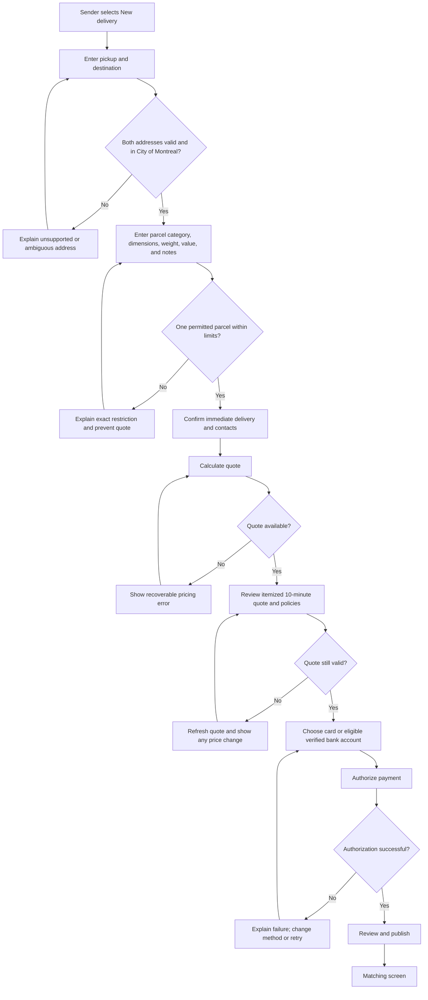

### Form and validation rules

- The MVP clearly labels the request as immediate; scheduled delivery is not offered.
- Address validation distinguishes unsupported geography from an address that merely needs correction.
- Parcel entry displays the 25 kg and 100 cm × 70 cm × 60 cm limits before submission.
- The sender must affirm packaging, category, value, and prohibited-item declarations.
- The quote shows subtotal, taxes, approved pass-through charges, total, expiry, and cancellation summary.
- If a refreshed quote changes, require explicit acceptance of the new total.
- Preserve request data after payment failure or temporary pricing failure.
- Publishing is a distinct final action after successful authorization.

## 9. UF-04 — Automated matching and driver offer

**Goal:** Assign exactly one eligible driver through explainable sequential offers without sender selection or routine human dispatch.

**PRD trace:** FR-007 through FR-015, FR-026; AC-003, AC-004, AC-005.

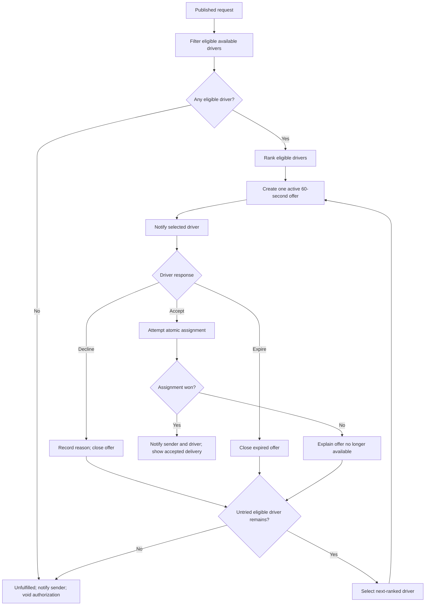

### Sender matching experience

- Show matching, not a fictional driver search animation that implies a result.
- Show the request summary, authorized amount, cancellation option, and elapsed time.
- Do not reveal rejected or expired drivers to the sender.
- On assignment, show only policy-approved driver, vehicle, ETA, and contact information.
- On unfulfilled outcome, explain that no charge was captured and offer **Retry**, **Edit request**, or **Return home**.

### Driver offer experience

- Immediately show the 60-second countdown.
- Show pickup and destination areas, estimated distance and duration, parcel size/weight/category, handling notes, and guaranteed payout.
- Do not reveal unnecessary sender personal information before acceptance.
- Accept and decline are equally understandable; no manipulative confirmation pattern.
- On expiry or lost assignment, disable acceptance and explain that the offer is closed.
- A decline-reason prompt may follow the decline but must not block timely dismissal.

## 10. UF-05 — Assignment, arrival, and pickup

**Goal:** Move a matched delivery into custody only after the driver arrives, the pickup code is verified, and payment capture is safely initiated.

**PRD trace:** FR-016, FR-017, FR-026, FR-029; AC-012.

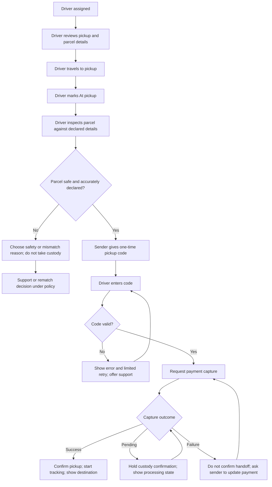

### UX rules

- The driver must be safely stopped to perform pickup actions.
- Show a parcel mismatch or unsafe-item path before custody is accepted.
- The sender sees arrival status and the pickup code, with a warning not to share it before physical handoff.
- Rate-limit pickup-code attempts and provide support after repeated failure.
- Do not tell either party that pickup succeeded until the authoritative state confirms it.
- If capture is pending, do not require the driver to take custody.
- On confirmed pickup, notify both parties and start precise sender-visible tracking.

## 11. UF-06 — Active delivery and live tracking

**Goal:** Give both parties truthful delivery progress while protecting driver privacy and handling location interruption.

**PRD trace:** FR-016, FR-018, FR-019, FR-020, FR-026; AC-006, AC-007.

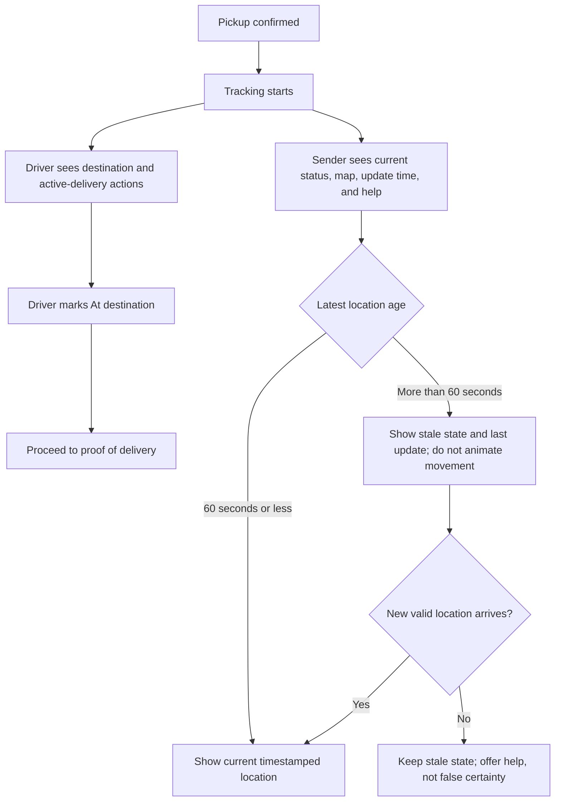

### Driver permission states

- Driver must grant required location permission before going available.
- If permission is revoked before accepting an offer, prevent availability and explain how to restore it.
- If permission is lost during an active delivery, keep the delivery active, show an urgent driver warning, mark sender tracking stale, and guide the driver to restore permission or contact support.
- Network loss queues only safe, ordered updates and never fabricates location.

### Sender tracking states

- **Current:** Map/location with visible last-update time.
- **Stale:** Last known location with explicit stale label and no implied movement.
- **Unavailable:** No usable location; show delivery state and help path.
- **Ended:** Hide live location after delivered, failed, or cancelled; retain only policy-approved history.

## 12. UF-07 — Delivery completion, proof, rating, and issue window

**Goal:** Complete the delivery with credible photo evidence while minimizing unnecessary personal data.

**PRD trace:** FR-021, FR-022, FR-024, FR-027; AC-008.

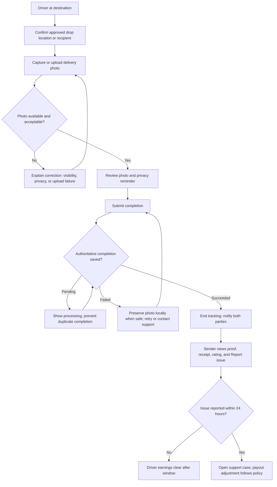

### Photo-proof rules

- Show framing guidance before capture: parcel plus destination context, not a close-up of a person's face.
- Allow review and retake before submission.
- Record upload progress and do not lose the delivery state on interruption.
- Do not mark delivered until completion and proof are durably acknowledged.
- Sender can view the photo only for the applicable delivery.
- Explain the 24-hour issue-reporting window on the completion screen.

## 13. UF-08 — Cancellation

**Goal:** Apply the correct cancellation consequence for the current state and make the financial effect explicit before confirmation.

**PRD trace:** FR-023, FR-032; AC-011.

### 13.1 Sender cancellation

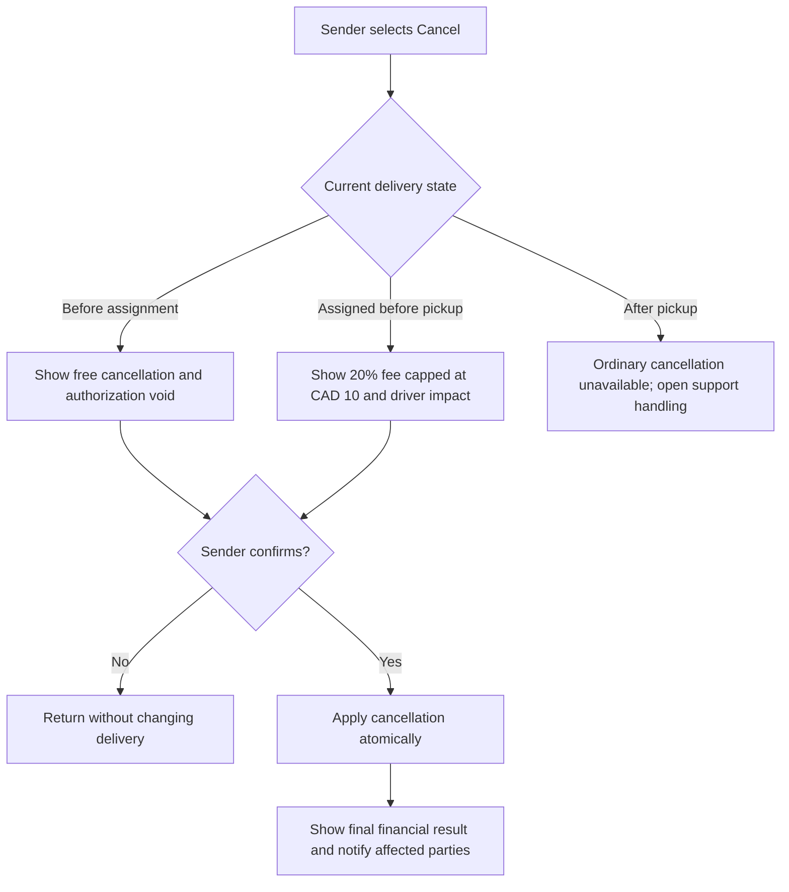

### 13.2 Driver cancellation

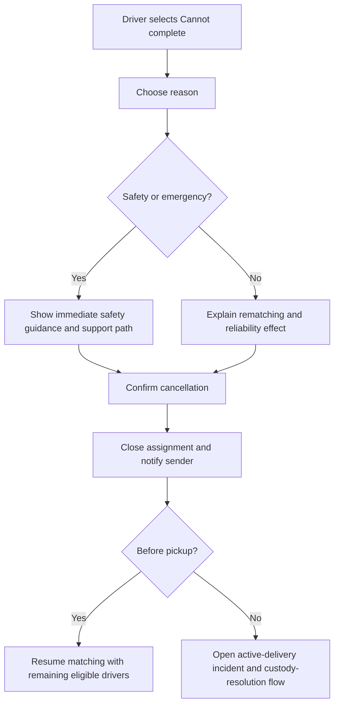

### UX rules

- Always show the exact current charge before sender confirmation.
- Do not use a generic cancellation message across lifecycle states.
- Require a reason after the user has safely initiated cancellation; do not trap a safety cancellation behind a long form.
- Record the resulting refund, charge, driver credit, reliability event, and notifications.

## 14. UF-09 — Failed delivery, return, or redelivery

**Goal:** Protect the parcel and guide both parties when delivery cannot be completed.

**PRD trace:** FR-016, FR-023, FR-024, FR-026, FR-032; PRD 8.8.

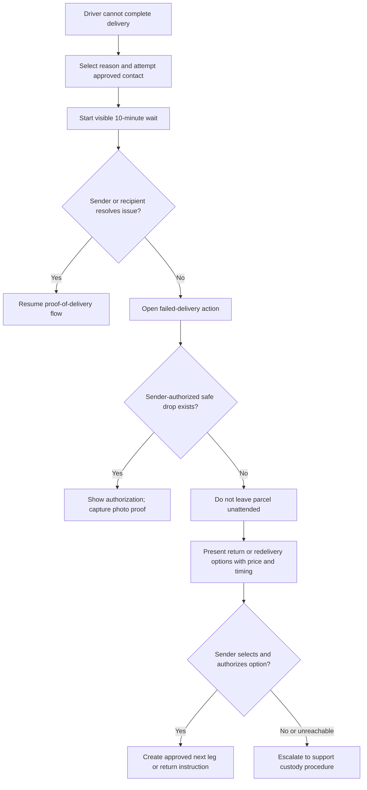

### UX rules

- The wait timer starts only after an approved contact attempt is recorded.
- Show the sender the failed-delivery reason and the parcel's custody status.
- Never allow an unattended drop without explicit sender authorization and appropriate proof.
- Return or redelivery price and payment effect must be shown before confirmation.
- Support sees a complete timeline and custody status.

## 15. UF-10 — Payment, refund, driver ledger, and weekly payout

**Goal:** Make sender charges and driver earnings understandable and reconcile every financial transition.

**PRD trace:** FR-004, FR-028 through FR-032; AC-009, AC-010.

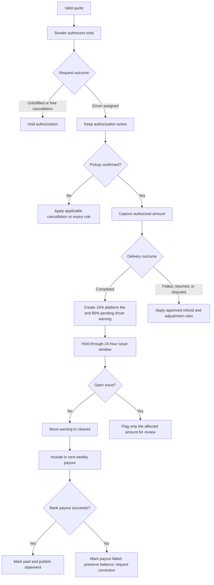

### Sender financial states

- Quote available / expired
- Authorization processing / authorized / failed / voided
- Capture processing / captured / failed
- Refund pending / refunded / refund failed
- Receipt available

### Driver financial states

- Estimated payout on offer
- Pending after completion
- Under issue review
- Cleared
- Included in payout
- Paid
- Payout failed, with balance preserved
- Adjusted, with reason and audit reference

## 16. UF-11 — Rating and issue reporting

**Goal:** Collect useful trust signals without hiding a support request inside a rating.

**PRD trace:** FR-027; PRD 8.7.

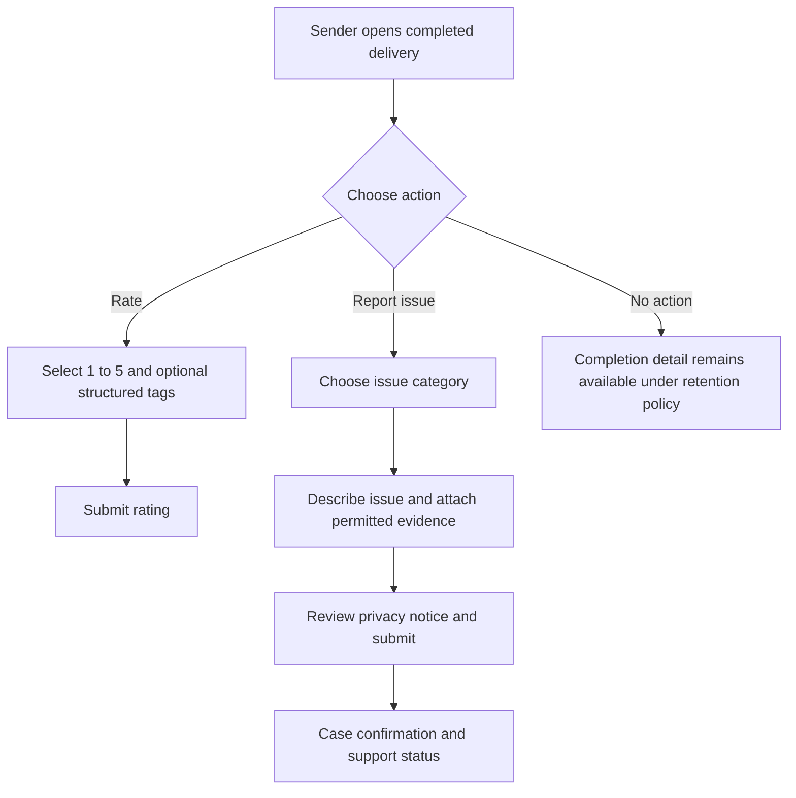

### UX rules

- Rating is optional and separate from issue reporting.
- Show issue-report deadline clearly.
- Do not show a driver's public aggregate until the minimum five-rated-delivery threshold is met.
- Do not let one rating silently change a completed delivery's financial state.
- Support cases have a visible status and do not expose internal notes.

## 17. Delivery, offer, payment, and tracking state models

### 17.1 Delivery state model

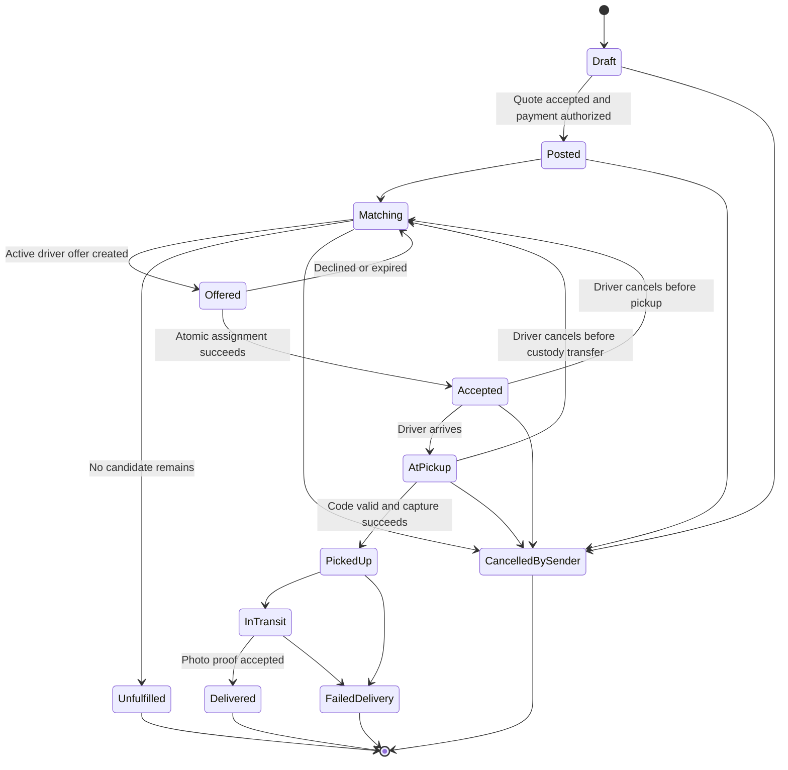

Driver cancellation before custody is an assignment event, not a terminal delivery outcome: it returns the request to matching when another eligible driver may be offered the work. The TDD must refine exceptional transitions for rematching, return, redelivery, payment failure, and support resolution without contradicting the user-visible states.

### 17.2 Offer state model

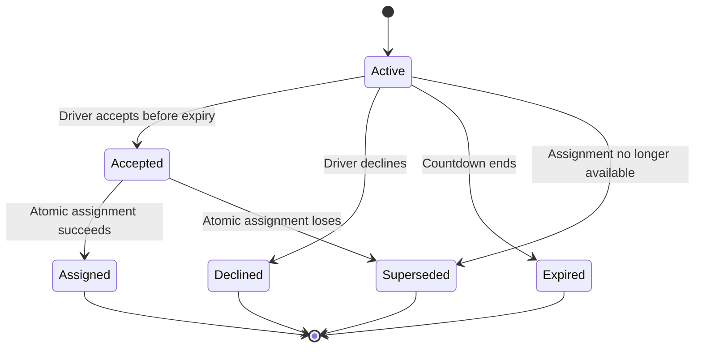

### 17.3 Tracking state model

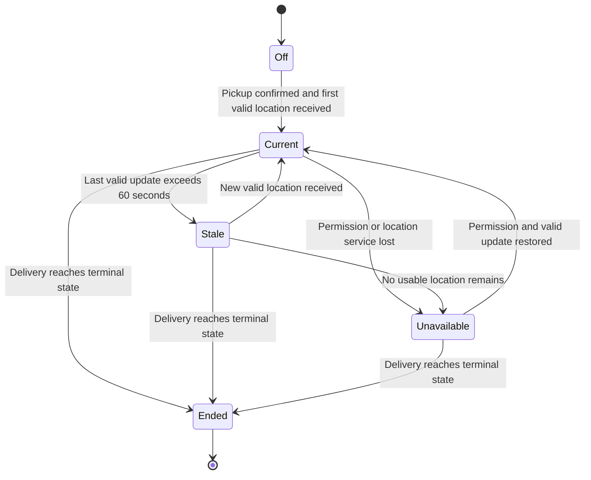

## 18. Notification matrix

| Event | Sender | Driver | Channel priority |
|---|---|---|---|
| Payment authorized | Confirmation | — | In-app; email receipt when captured |
| Matching started | Matching state | — | In-app |
| Driver offer created | — | Offer and countdown | Immediate push/foreground alert plus in-app |
| Driver assigned | Driver and ETA | Accepted job | Immediate alert plus in-app |
| Driver at pickup | Arrival and pickup code reminder | Pickup action | Immediate alert plus in-app |
| Pickup confirmed | Tracking available | Active delivery | Immediate alert plus in-app |
| Tracking stale | Stale warning | Restore-location warning | In-app; immediate driver alert |
| Cancellation | State and financial effect | State and financial effect | Immediate alert, in-app, and email for financial receipt |
| No driver available | Unfulfilled and no-charge result | — | Immediate alert plus in-app |
| Delivery completed | Proof and issue window | Pending earning | Immediate alert, in-app, and email summary |
| Issue opened | Case confirmation | Only when policy requires notice | In-app and email |
| Payout sent or failed | — | Statement or correction action | In-app and email |

## 19. Common UX states

Every networked screen that changes money, assignment, custody, or delivery status must define:

- **Initial:** Existing authoritative state is visible before action.
- **Submitting:** Action is disabled against accidental duplication and remains truthfully pending.
- **Succeeded:** Confirmed authoritative outcome and next action are visible.
- **Failed safely:** No false success; user sees what was preserved and how to retry or get help.
- **Unknown outcome:** Product checks authoritative status before allowing another consequential attempt.
- **Offline:** Read-only cached information is labeled; prohibited consequential actions remain unavailable unless an approved offline design exists.
- **Expired:** Quote, offer, code, permission, or document is no longer valid and has a clear recovery path.
- **Unauthorized:** No sensitive data leaks; user receives an appropriate sign-in, access, or support path.
- **Empty:** Explain what the list represents and the primary next action without invented data.

## 20. Content, privacy, and accessibility requirements

- Use the user's selected French or English consistently across each flow.
- Prefer plain terms such as **delivery request**, **driver offer**, **payment authorization**, **pickup confirmed**, and **last updated**.
- Never label a payment authorization as a completed charge.
- Never label a driver offer as an assignment before atomic assignment succeeds.
- Never label stale location as live.
- Present cancellation charges before the final confirmation action.
- Mask unnecessary addresses and personal information until the delivery relationship requires them.
- Do not expose one user's support notes or verification documents to another user.
- Provide text alternatives for maps, icons, countdowns, photos, status colors, and progress indicators.
- Countdown expiry must be conveyed programmatically without announcing every second to assistive technology.
- Photo capture must offer an accessible upload alternative.
- Confirmation and error messages must identify the affected delivery without relying on color or map position.

## 21. Requirements-to-flow traceability

| PRD requirements | UX flows |
|---|---|
| FR-001, FR-035 | UF-01 account, role, and language |
| FR-006, FR-007 | UF-02 driver onboarding and verification |
| FR-002–FR-004, FR-028, FR-029, FR-033 | UF-03 sender request, quote, payment, and publication |
| FR-007–FR-015, FR-026 | UF-04 automated matching and driver offer |
| FR-016, FR-017, FR-026, FR-029 | UF-05 assignment, arrival, and pickup |
| FR-016, FR-018–FR-020, FR-026 | UF-06 active delivery and tracking |
| FR-021, FR-022, FR-024, FR-027 | UF-07 completion, proof, rating, and issue window |
| FR-023, FR-032 | UF-08 cancellation |
| FR-016, FR-023, FR-024, FR-026, FR-032 | UF-09 failed delivery, return, and redelivery |
| FR-004, FR-028–FR-032 | UF-10 payment, refund, ledger, and payout |
| FR-027 | UF-11 rating and issue reporting |
| FR-005, FR-024, FR-025 | Delivery detail, audit timeline, and support screens |
| FR-034 | SMS notifications, post-MVP |

All 35 PRD functional requirements are represented in at least one flow, screen, state model, or cross-cutting requirement.

## 22. Inputs required by the TDD

The TDD must preserve these UX contracts:

1. Stable delivery, offer, payment, payout, tracking, and verification states.
2. Atomic single-driver assignment and truthful losing-acceptance behavior.
3. Quote and offer expiry that cannot be bypassed by delayed clients.
4. Idempotent consequential actions and recoverable unknown outcomes.
5. Payment authorization before publication and capture before custody confirmation.
6. Driver ledger and payout states that reconcile to delivery and payment events.
7. Pickup-code validation with attempt limits and support recovery.
8. Photo upload that survives safe retries without duplicate completion.
9. Location freshness, permission loss, retention, and terminal-state shutdown.
10. Role- and relationship-based access to addresses, location, proof, payment, and support data.
11. Notification delivery that does not become the source of truth.
12. Bilingual content delivery and accessible state semantics.
13. Audit history for every material state and financial transition.
14. Analytics that measure the PRD funnel without exposing unnecessary personal data.

## 23. Review checklist

The UX flows are ready to become TDD input when:

- Product confirms that each flow matches the PRD and commercial policy.
- Design confirms that every consequential action has initial, pending, success, failure, and recovery states.
- Operations confirms cancellation, failed-delivery, support, and custody flows.
- Finance confirms user-visible authorization, capture, refund, fee, adjustment, and payout language.
- Privacy and security confirm location, photo, identity, and cross-user visibility rules.
- Accessibility and language review cover the complete P0 journey.
- Wireframes can reference stable screen IDs without inventing new product rules.
- The technical owner accepts the UX contracts as inputs to the TDD.

## 24. Approval record

| Role | Name | Decision | Date |
|---|---|---|---|
| Product owner | Founder / product lead | Approved for Phase 0 and the Phase 1 sender-draft flow only | 2026-10-28 |
| Product design | TBD | Pending | — |
| Technical owner | Jed Bonheur | Assigned; UX-contract acceptance pending | — |
| Operations / risk | TBD | Pending | — |
| Finance / payments | TBD | Pending | — |
| Security / privacy | TBD | Pending | — |

