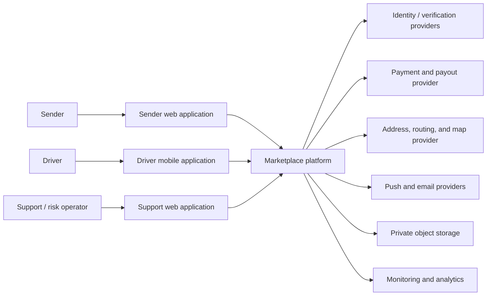
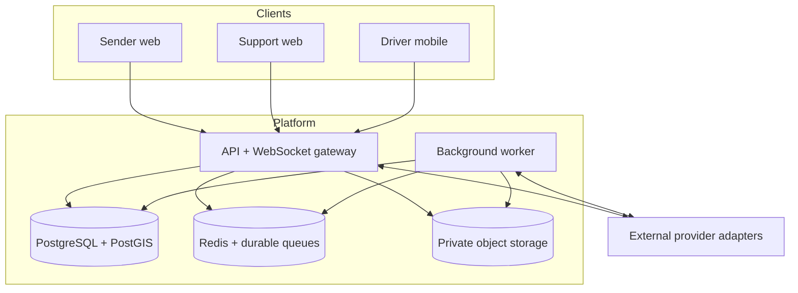
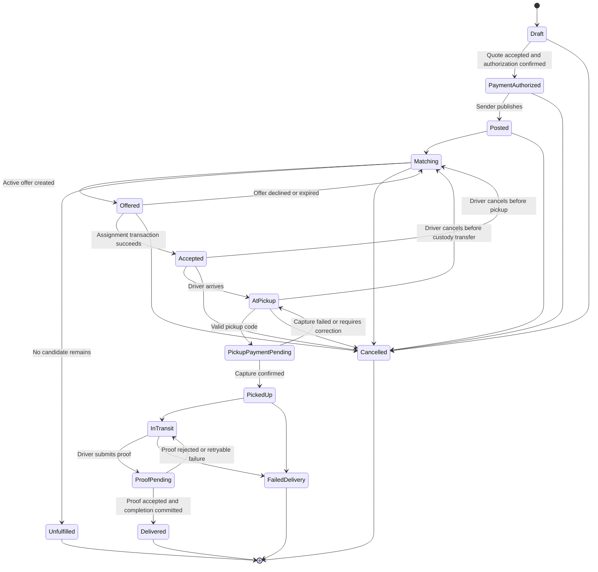
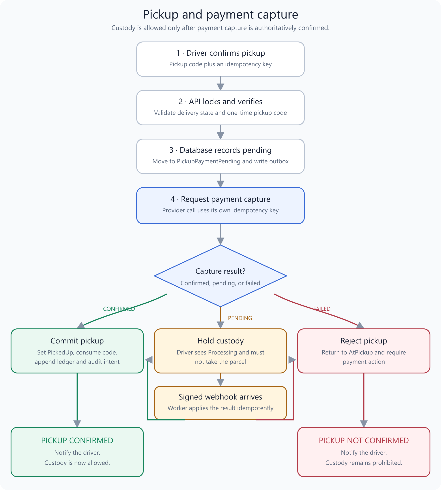
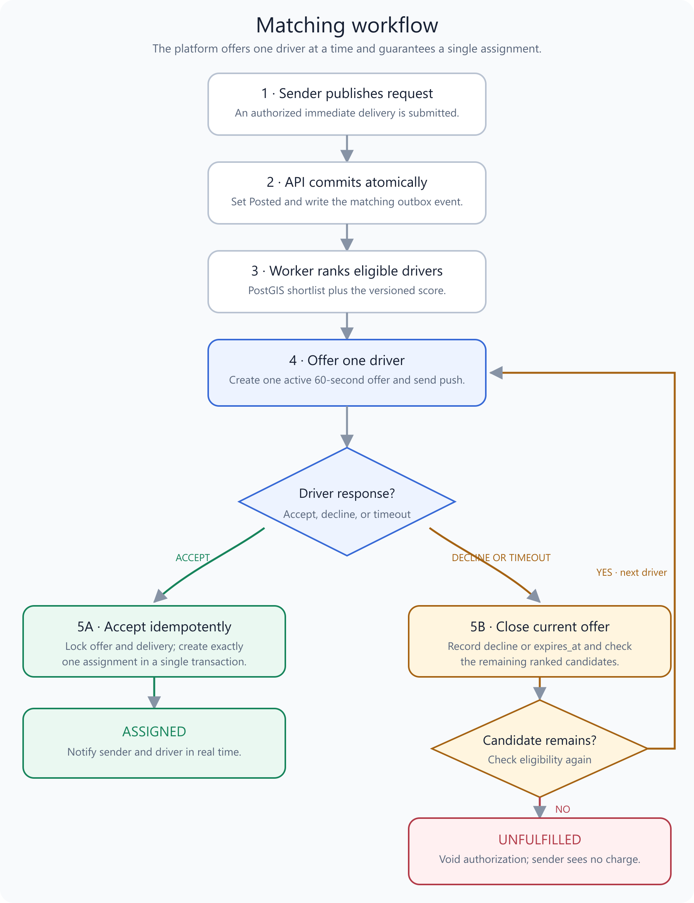
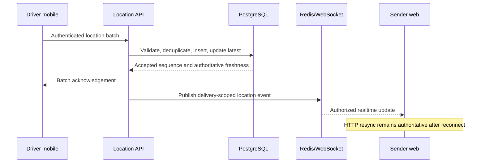

# Technical Design Document: Montreal Immediate Delivery Marketplace MVP

| Field | Value |
|---|---|
| Status | v0.2 — product-owner approved for Phase 0/1 scope; activation gates remain in Section 36 |
| Product | Automated two-sided delivery marketplace |
| Project | Montreal Immediate Delivery Marketplace MVP |
| Repository name | `dtpm` — absolute path pending |
| Product inputs | `docs/product/PRD.md` v0.3 and `docs/product/UX_FLOWS.md` v0.2 |
| Technical owner | Jed Bonheur — technical acceptance pending |
| Last updated | 2026-10-28 |

## Contents

- [1. Purpose](#1-purpose)
- [2. Source-of-truth hierarchy](#2-source-of-truth-hierarchy)
- [3. Scope](#3-scope)
  - [3.1 In scope](#31-in-scope)
  - [3.2 Out of scope](#32-out-of-scope)
- [4. Architecture goals and constraints](#4-architecture-goals-and-constraints)
- [5. Proposed technical decisions](#5-proposed-technical-decisions)
- [6. Architecture decision: modular monolith](#6-architecture-decision-modular-monolith)
  - [Why not microservices](#why-not-microservices)
  - [Extraction signals](#extraction-signals)
- [7. System context](#7-system-context)
- [8. Container architecture](#8-container-architecture)
- [9. Proposed repository shape](#9-proposed-repository-shape)
- [10. Backend module boundaries](#10-backend-module-boundaries)
- [11. Data conventions](#11-data-conventions)
- [12. Core data model](#12-core-data-model)
  - [12.1 Identity and driver](#121-identity-and-driver)
  - [12.2 Delivery and matching](#122-delivery-and-matching)
  - [12.3 Tracking, proof, support, and notification](#123-tracking-proof-support-and-notification)
  - [12.4 Payment, ledger, and payout](#124-payment-ledger-and-payout)
  - [12.5 Reliability infrastructure](#125-reliability-infrastructure)
- [13. Delivery state machine](#13-delivery-state-machine)
- [14. Offer and assignment concurrency](#14-offer-and-assignment-concurrency)
  - [14.1 Constraints](#141-constraints)
  - [14.2 Atomic acceptance algorithm](#142-atomic-acceptance-algorithm)
- [15. Idempotency and consistency model](#15-idempotency-and-consistency-model)
  - [15.1 Idempotent commands](#151-idempotent-commands)
  - [15.2 Outbox and inbox](#152-outbox-and-inbox)
  - [15.3 Consistency](#153-consistency)
- [16. Pricing and quote design](#16-pricing-and-quote-design)
  - [16.1 Quote inputs](#161-quote-inputs)
  - [16.2 Calculation](#162-calculation)
  - [16.3 Quote lifecycle](#163-quote-lifecycle)
- [17. Payment, ledger, and payout architecture](#17-payment-ledger-and-payout-architecture)
  - [17.1 Provider boundary](#171-provider-boundary)
  - [17.2 Pickup and capture saga](#172-pickup-and-capture-saga)
  - [17.3 Ledger model](#173-ledger-model)
  - [17.4 Payout lifecycle](#174-payout-lifecycle)
- [18. Matching design](#18-matching-design)
  - [18.1 Candidate pipeline](#181-candidate-pipeline)
  - [18.2 Score](#182-score)
  - [18.3 Matching workflow](#183-matching-workflow)
  - [18.4 Failure behavior](#184-failure-behavior)
- [19. Location and realtime design](#19-location-and-realtime-design)
  - [19.1 Driver application requirement](#191-driver-application-requirement)
  - [19.2 Ingestion](#192-ingestion)
  - [19.3 Storage and fan-out](#193-storage-and-fan-out)
  - [19.4 Staleness](#194-staleness)
  - [19.5 Location sequence](#195-location-sequence)
- [20. Proof-of-delivery design](#20-proof-of-delivery-design)
  - [20.1 Upload flow](#201-upload-flow)
  - [20.2 Security and privacy](#202-security-and-privacy)
- [21. API design](#21-api-design)
  - [21.1 Sender and delivery](#211-sender-and-delivery)
  - [21.2 Driver](#212-driver)
  - [21.3 Support](#213-support)
  - [21.4 Errors](#214-errors)
- [22. Realtime event contract](#22-realtime-event-contract)
- [23. Authentication and authorization](#23-authentication-and-authorization)
  - [23.1 Authentication](#231-authentication)
  - [23.2 Authorization](#232-authorization)
- [24. Security and privacy design](#24-security-and-privacy-design)
  - [24.1 Threats and controls](#241-threats-and-controls)
  - [24.2 Encryption and secrets](#242-encryption-and-secrets)
  - [24.3 Retention](#243-retention)
- [25. Notifications and localization](#25-notifications-and-localization)
  - [25.1 Notification architecture](#251-notification-architecture)
  - [25.2 Localization](#252-localization)
- [26. Observability and audit](#26-observability-and-audit)
  - [26.1 Telemetry](#261-telemetry)
  - [26.2 Required metrics](#262-required-metrics)
  - [26.3 Audit](#263-audit)
- [27. Reliability and failure recovery](#27-reliability-and-failure-recovery)
  - [27.1 Retry policy](#271-retry-policy)
  - [27.2 Backup and recovery targets](#272-backup-and-recovery-targets)
- [28. Performance and design envelope](#28-performance-and-design-envelope)
  - [Performance targets](#performance-targets)
  - [Performance strategy](#performance-strategy)
- [29. Testing and verification strategy](#29-testing-and-verification-strategy)
  - [29.1 Test layers](#291-test-layers)
  - [29.2 Mandatory concurrency scenarios](#292-mandatory-concurrency-scenarios)
  - [29.3 Acceptance traceability](#293-acceptance-traceability)
- [30. CI/CD and environments](#30-cicd-and-environments)
  - [30.1 Environments](#301-environments)
  - [30.2 Continuous integration](#302-continuous-integration)
  - [30.3 Deployment](#303-deployment)
- [31. Data migration and versioning](#31-data-migration-and-versioning)
- [32. Implementation phases](#32-implementation-phases)
  - [Phase 0 — Repository and quality foundation](#phase-0--repository-and-quality-foundation)
  - [Phase 1 — First vertical slice: sender delivery draft](#phase-1--first-vertical-slice-sender-delivery-draft)
  - [Phase 2 — Driver onboarding and availability](#phase-2--driver-onboarding-and-availability)
  - [Phase 3 — Quote, payment authorization, and publication](#phase-3--quote-payment-authorization-and-publication)
  - [Phase 4 — Matching, offer, and atomic assignment](#phase-4--matching-offer-and-atomic-assignment)
  - [Phase 5 — Pickup and live tracking](#phase-5--pickup-and-live-tracking)
  - [Phase 6 — Proof, completion, cancellation, and issues](#phase-6--proof-completion-cancellation-and-issues)
  - [Phase 7 — Ledger, fee, payout, and reconciliation](#phase-7--ledger-fee-payout-and-reconciliation)
  - [Phase 8 — Pilot hardening and release gate](#phase-8--pilot-hardening-and-release-gate)
- [33. Feature flags and operational controls](#33-feature-flags-and-operational-controls)
- [34. Alternatives considered](#34-alternatives-considered)
  - [34.1 Browser-only driver PWA](#341-browser-only-driver-pwa)
  - [34.2 Microservices](#342-microservices)
  - [34.3 Document database as primary store](#343-document-database-as-primary-store)
  - [34.4 Redis as assignment source of truth](#344-redis-as-assignment-source-of-truth)
  - [34.5 Polling-only tracking](#345-polling-only-tracking)
  - [34.6 Direct provider calls from domain modules](#346-direct-provider-calls-from-domain-modules)
- [35. Technical decisions still requiring approval](#35-technical-decisions-still-requiring-approval)
- [36. TDD approval and implementation gate](#36-tdd-approval-and-implementation-gate)
  - [36.1 Product-owner approval for Phase 0/1](#361-product-owner-approval-for-phase-01)
  - [36.2 Phase 0 activation gate](#362-phase-0-activation-gate)
  - [36.3 Phase 1 activation gate](#363-phase-1-activation-gate)
  - [36.4 Explicit exclusions](#364-explicit-exclusions)
- [37. Review checklist](#37-review-checklist)
- [38. Technical references](#38-technical-references)
- [39. Approval record](#39-approval-record)

## 1. Purpose

[↑ Contents](#contents)

This document proposes how the MVP product behavior in the current PRD and UX-flow drafts will be implemented. It turns those product inputs into system boundaries, technical decisions, domain models, contracts, state transitions, concurrency rules, provider interfaces, security controls, observability, verification, deployment, and implementation phases. Implementation approval can occur only after the product inputs and this TDD pass their respective reviews.

The TDD is the technical source of truth for initializing a fresh repository. It does not authorize production deployment, use of real payments, collection of real identity documents, or launch of the Montreal pilot. Those actions require the approval gates defined here and in the PRD.

## 2. Source-of-truth hierarchy

[↑ Contents](#contents)

When documents conflict, resolve the conflict rather than silently choosing one:

1. Approved PRD owns product goals, scope, business rules, and acceptance criteria.
2. Approved UX flows own user-visible states, transitions, recovery behavior, and screen contracts.
3. This TDD owns implementation architecture and technical tradeoffs.
4. API schemas, database migrations, and executable tests must conform to all three.
5. Observed verification evidence—not plans—determines whether implementation is complete.

## 3. Scope

[↑ Contents](#contents)

### 3.1 In scope

- Sender web application
- Driver iOS and Android application
- Support and risk administration web application
- Authentication, roles, verification status, and account standing
- Immediate Montreal delivery request, parcel validation, quote, and publication
- Payment authorization, capture, refund, fee calculation, driver ledger, and weekly payout
- Automated eligibility filtering, ranking, sequential offers, and atomic assignment
- Pickup-code confirmation
- Background driver location ingestion and sender-visible tracking
- Delivery photo upload and proof access
- Cancellation, failed delivery, return/redelivery, rating, and issue reporting
- Notifications, audit history, product analytics, observability, and pilot controls
- French and English content delivery

### 3.2 Out of scope

- Scheduled delivery implementation
- SMS notifications
- Multi-stop routing and route optimization
- Driver bidding or sender-selected drivers
- Machine-learning matching
- Dynamic or surge pricing
- Multiple cities or enterprise tenants
- Automated claims adjudication
- Microservice decomposition
- Production infrastructure selection before provider and operational review

## 4. Architecture goals and constraints

[↑ Contents](#contents)

| Goal or constraint | Technical implication |
|---|---|
| Prevent double assignment | Database-enforced uniqueness, row locking, atomic state transition, idempotent acceptance |
| Reliable background tracking | Native-capable driver application with explicit background-location permission and recovery states |
| Truthful consequential actions | Authoritative server state, pending/unknown outcomes, idempotency keys, safe retries |
| Explainable matching | Versioned score inputs, stored match-run evidence, no opaque ML model |
| Payment and payout reconciliation | Provider webhooks, append-only double-entry ledger, immutable references, reconciliation jobs |
| Privacy by delivery state | Relationship-based authorization, short location retention, private proof storage, signed access |
| Small MVP team | Modular monolith and shared TypeScript contracts rather than distributed microservices |
| Replaceable vendors | Ports-and-adapters boundaries for payments, maps, identity, notifications, object storage, and analytics |
| Bilingual product | Locale-aware content keys and persisted language preference; no hard-coded user-facing strings |
| Recoverable background work | Durable queues plus PostgreSQL as authoritative source of truth |

## 5. Proposed technical decisions

[↑ Contents](#contents)

These decisions are proposed for architecture review. Exact supported dependency versions will be selected and locked when the repository is initialized.

| ID | Decision | Rationale |
|---|---|---|
| TD-001 | Use a TypeScript monorepo | Shared language and contracts across web, mobile, API, worker, and tests reduce translation errors for a small team |
| TD-002 | Use a modular monolith backend | Preserves transactional consistency and development speed while maintaining domain boundaries that can be extracted later |
| TD-003 | Use a server-rendered React web application for sender and support surfaces | Accessible responsive web delivery suits senders and internal operators; separate route groups can share design and localization infrastructure |
| TD-004 | Use a React Native driver application with native development builds | Reliable background location, push notifications, camera upload, and secure device storage are core driver requirements |
| TD-005 | Use a structured Node.js backend framework for HTTP, WebSocket, validation, dependency injection, and workers | Keeps transport concerns separate from domain modules and supports shared policies and testing |
| TD-006 | Use PostgreSQL with PostGIS as the authoritative database | Relational transactions suit assignment and money; PostGIS supports indexed Montreal-boundary and proximity queries |
| TD-007 | Use Redis-backed durable jobs for expiry, notifications, retention, reconciliation, and payouts | Time-based and retryable work must survive process restarts; Redis is not the business source of truth |
| TD-008 | Use HTTP for commands and mobile location batches; use WebSockets for authorized downstream updates | HTTP is easier to retry safely from mobile; WebSockets reduce tracking and status latency for connected viewers |
| TD-009 | Use private object storage with short-lived signed upload/download URLs | Delivery photos and verification documents must not pass through public URLs or be stored in the relational database |
| TD-010 | Use an outbox pattern for domain events and background jobs | Prevents committed business state from losing its matching notification, audit, or async work |
| TD-011 | Use an append-only double-entry ledger | Driver payable, platform revenue, refunds, adjustments, and payout balances must reconcile without overwriting financial history |
| TD-012 | Keep external providers behind typed adapters | Payment, mapping, identity, notification, and storage vendors remain replaceable and testable |

## 6. Architecture decision: modular monolith

[↑ Contents](#contents)

The backend is one codebase organized into strict modules and initially deployed as two process types:

- **API process:** HTTP APIs, WebSocket gateway, authentication enforcement, validation, and synchronous application services.
- **Worker process:** durable jobs, provider webhooks after validation, matching continuation, expiry, notifications, retention, reconciliation, and payouts.

Both processes share domain and application packages and use the same PostgreSQL database. Redis holds queues, short-lived connection/presence data, rate-limit counters, and caches only. Business truth remains in PostgreSQL.

### Why not microservices

Microservices would add distributed transactions, multiple deployment pipelines, inter-service authentication, duplicated observability, and more failure modes before the team has validated product demand. Module boundaries and an outbox preserve a future extraction path without paying that operational cost now.

### Extraction signals

A module may later become a service only when evidence shows an independent scaling, ownership, reliability, compliance, or deployment need. Candidate boundaries include location ingestion, notifications, and payment/payout processing.

## 7. System context

[↑ Contents](#contents)



## 8. Container architecture

[↑ Contents](#contents)



## 9. Proposed repository shape

[↑ Contents](#contents)

```text
apps/
├── sender-web/          # Sender-facing responsive web application
├── admin-web/           # Support and risk operations web application
├── driver-mobile/       # iOS/Android driver application
├── api/                 # HTTP API and WebSocket gateway
└── worker/              # Queue consumers and scheduled jobs
packages/
├── domain/              # Entities, value objects, state policies, domain events
├── application/         # Use cases and ports, independent of transports/providers
├── contracts/           # Versioned API/event schemas and generated client types
├── persistence/         # Database schema, migrations, repositories, outbox
├── providers/           # Payment, maps, messaging, identity, and storage adapters
├── auth/                # Shared authorization policies and principal types
├── i18n/                # French/English keys and validation tooling
├── observability/       # Logging, metrics, traces, correlation helpers
├── testing/             # Fixtures, fakes, contract tests, test builders
└── config/              # Typed environment configuration
docs/
├── product/
└── technical/
infra/                   # Environment manifests after hosting approval
```

The repository is not created by this TDD. The shape is an implementation recommendation to be applied after architecture approval.

## 10. Backend module boundaries

[↑ Contents](#contents)

| Module | Responsibilities | Must not own |
|---|---|---|
| Identity | User identity links, roles, sessions, account standing | Provider credentials or driver verification policy |
| Driver | Driver profile, vehicle, service area, verification status, availability | Matching selection or payouts |
| Delivery | Delivery aggregate, parcel/address snapshots, lifecycle, pickup code, cancellation policy | External payment calls or location transport |
| Pricing | Rate-card versions, quote calculation, quote expiry, price breakdown | Capturing money |
| Payment | Authorization, capture, refund, provider events, reconciliation | Driver balance calculation |
| Matching | Eligibility, candidate scoring, match runs, sequential offers, assignment command | Driver onboarding or route-provider implementation |
| Location | Permission status, location ingestion, validation, latest state, history retention | Delivery lifecycle authority |
| Proof | Signed upload sessions, photo metadata, validation status, proof access | Delivery completion authority |
| Ledger | Double-entry financial transactions, driver payable, platform revenue, adjustments | Provider payout execution |
| Payout | Payout batches, transfers, statements, failure recovery | Rewriting ledger entries |
| Notification | Templates, locale, preferences, delivery attempts | Authoritative business state |
| Support | Issue cases, approved exception commands, internal timelines | Routine matching or unrestricted data access |
| Audit | Append-only material action record | Product analytics or mutable operational state |
| Analytics | Privacy-appropriate funnel events and metrics | Source-of-truth state transitions |

Modules communicate through application ports and committed domain events. Direct cross-module table writes are prohibited.

## 11. Data conventions

[↑ Contents](#contents)

- Application-generated UUIDs identify records; identifiers are opaque to clients.
- Timestamps are stored in UTC with timezone-aware types; user presentation uses Montreal local time where relevant.
- Money is stored as integer minor units plus ISO currency code. Floating-point money is prohibited.
- Distances are stored in meters and weights in grams; UI converts to approved user units.
- Address, parcel, quote, and payout inputs used for a delivery are snapshotted so later profile changes do not rewrite history.
- Mutable aggregates carry an integer `version` for optimistic conflict detection and event ordering.
- Provider identifiers are stored as references; raw secrets, card data, and bank credentials are never stored.
- Soft deletion is not a substitute for an explicit retention and erasure policy.

## 12. Core data model

[↑ Contents](#contents)

### 12.1 Identity and driver

| Table / aggregate | Important fields and constraints |
|---|---|
| `users` | id, identity-provider subject unique, email/phone verification state, preferred locale, standing, created_at |
| `user_roles` | user_id + role unique; sender, driver, support, risk-admin |
| `driver_profiles` | user_id unique, verification_status, availability_status, rating summary, reliability counters, current_vehicle_id |
| `vehicles` | driver_id, type, capacity dimensions/weight, registration status, active flag |
| `verification_items` | driver_id, type, status, provider reference, issued/expiry dates, review metadata; no raw document in DB |
| `driver_presence` | driver_id unique, availability heartbeat, last geography point, accuracy, updated_at; geospatial index |
| `payout_accounts` | driver_id, provider account reference, status, ownership verification; no bank credentials |

### 12.2 Delivery and matching

| Table / aggregate | Important fields and constraints |
|---|---|
| `deliveries` | id, sender_id, state, version, assigned_driver_id nullable, quote_id, parcel snapshot, pickup/destination snapshots, timestamps |
| `delivery_contacts` | delivery_id, role, encrypted contact fields, access policy metadata |
| `delivery_events` | delivery_id, sequence unique, type, actor, previous/new state, reason, occurred_at, sanitized metadata |
| `quotes` | id, sender_id, route snapshot, rate_card_version, subtotal/tax/pass-through/total, currency, expires_at, accepted_at |
| `rate_cards` | version, effective range, base/distance/size/weight rules, status, approval reference |
| `match_runs` | delivery_id, algorithm_version, candidate snapshot, started/completed_at, outcome |
| `match_candidates` | match_run_id + driver_id unique, eligibility result, normalized score inputs, total score, rank, exclusion reason |
| `offers` | delivery_id, driver_id, state, expires_at, offered payout, version; at most one active offer per delivery |
| `assignments` | delivery_id unique, driver_id, accepted_offer_id unique, assigned_at, ended_at, end_reason |
| `pickup_codes` | delivery_id unique, salted code digest, failed_attempts, expires_at, consumed_at; never store plaintext code |

### 12.3 Tracking, proof, support, and notification

| Table / aggregate | Important fields and constraints |
|---|---|
| `location_samples` | delivery_id, driver_id, device_sequence, device_time, received_at, geography point, accuracy, source; unique delivery/device sequence |
| `delivery_location_latest` | delivery_id unique, latest sample reference, freshness state, updated_at |
| `proof_assets` | delivery_id, object key, media type, size, checksum, scan/validation status, captured_at, location evidence, retention_at |
| `ratings` | delivery_id + sender_id unique, driver_id, score, structured tags, submitted_at |
| `issue_cases` | delivery_id, reporter_id, category, status, priority, opened_at, resolution; internal notes stored separately |
| `notifications` | user_id, delivery_id nullable, template key/version, locale, channel, state, provider reference, attempts |
| `audit_entries` | actor, action, resource type/id, result, reason, correlation id, occurred_at, sanitized metadata; append-only |

### 12.4 Payment, ledger, and payout

| Table / aggregate | Important fields and constraints |
|---|---|
| `payment_transactions` | delivery_id, type, state, amount/currency, provider reference, idempotency key unique, failure category |
| `provider_events` | provider + event_id unique, signature_verified_at, processed_at, processing result |
| `refunds` | payment transaction, amount, reason, state, provider reference |
| `ledger_accounts` | account owner/type/currency unique; platform clearing, revenue, driver payable, refunds, fees |
| `ledger_transactions` | immutable business reference, type, occurred_at, reversal_of nullable |
| `ledger_entries` | transaction_id, account_id, debit/credit minor units; transaction entries must balance to zero |
| `payout_batches` | period, state, total, provider reference, created/sent/completed timestamps |
| `payout_items` | batch_id + driver_id, amount, state, statement reference, failure category |

### 12.5 Reliability infrastructure

| Table | Purpose |
|---|---|
| `outbox_events` | Domain events committed in the same transaction as business state and delivered asynchronously |
| `inbox_events` | Idempotently records consumed external or queue events |
| `idempotency_records` | Actor, operation, key, request hash, response/outcome reference, expiry |
| `job_checkpoints` | Optional durable cursor for long-running retention, reconciliation, and payout jobs |

## 13. Delivery state machine

[↑ Contents](#contents)

The database state machine is stricter than a client-side flow. Every transition is authorized and validated server-side.



`PickupPaymentPending` and `ProofPending` are technical states that support truthful UX while external or storage operations settle. Clients must not infer state from local action completion.

## 14. Offer and assignment concurrency

[↑ Contents](#contents)

### 14.1 Constraints

- At most one active offer exists for a delivery.
- A driver may have at most one active offer and one active assignment during the MVP.
- One delivery may have at most one active assignment.
- Offer expiry is determined by server time stored in `expires_at`.
- A queue job triggers expiry processing, but acceptance always re-checks database state and time.

### 14.2 Atomic acceptance algorithm

Within one PostgreSQL transaction:

1. Lock the offer row and delivery row for update.
2. Verify the authenticated driver owns the offer.
3. Verify offer state is active and server time is before `expires_at`.
4. Verify delivery is still offered, has no active assignment, and versions match.
5. Verify driver remains eligible and has no conflicting active assignment.
6. Insert the unique assignment.
7. Transition offer to accepted and delivery to accepted.
8. Close any obsolete offers.
9. Append delivery and audit events.
10. Insert outbox events for notifications and realtime updates.
11. Commit and return the authoritative outcome.

Unique constraints provide a final safety barrier. A losing concurrent acceptance returns a stable `OFFER_NO_LONGER_AVAILABLE` result rather than a generic server error.

## 15. Idempotency and consistency model

[↑ Contents](#contents)

### 15.1 Idempotent commands

The following require an `Idempotency-Key` scoped to authenticated actor and operation:

- Publish delivery
- Accept offer
- Confirm pickup
- Cancel delivery or assignment
- Create payment authorization/capture/refund
- Create proof upload session
- Complete delivery
- Submit rating or issue
- Create payout batch or send payout

The server stores the request hash and outcome. Reusing a key with a different payload is rejected. Reusing it with the same payload returns the original authoritative result.

### 15.2 Outbox and inbox

Business transactions write an outbox row in the same commit. A worker publishes or processes it and records delivery attempts. Consumers use inbox records or natural unique keys to make duplicate delivery safe.

### 15.3 Consistency

- Delivery state, assignment, payment references, ledger entries, and audit records are strongly consistent in PostgreSQL transactions.
- Notifications, analytics, realtime fan-out, and some provider synchronization are eventually consistent.
- Clients resynchronize from HTTP authoritative state after reconnecting; WebSocket messages are hints, not the source of truth.

## 16. Pricing and quote design

[↑ Contents](#contents)

### 16.1 Quote inputs

- Validated pickup and destination coordinates within the approved Montreal boundary
- Provider route distance and expected duration snapshot
- Parcel dimensions, weight, category, declared value, and handling flags
- Active approved rate-card version
- Applicable taxes and approved pass-through charges

### 16.2 Calculation

The pricing module uses deterministic decimal/integer arithmetic:

```text
delivery subtotal = base charge
                  + distance charge
                  + size-tier charge
                  + weight-tier charge
```

Tax and pass-through charges are separate. No surge multiplier exists in the MVP. The persisted quote contains the full calculation snapshot and rate-card version, so a later rate change cannot alter an accepted quote.

### 16.3 Quote lifecycle

- Quotes expire 10 minutes after server creation.
- Publication verifies the quote has not expired and the request inputs still match its calculation hash.
- Any material edit invalidates the quote and its payment authorization workflow.
- A refreshed quote that changes price requires explicit sender acceptance.
- Rate-card changes are versioned, approved, and never edit historical versions in place.

## 17. Payment, ledger, and payout architecture

[↑ Contents](#contents)

### 17.1 Provider boundary

The `PaymentProvider` port must support:

- Sender customer/payment-method references without exposing credentials
- Card authorization and capture
- Eligible verified-bank payment or a feature-gated alternative
- Authorization voids
- Full and partial refunds
- Connected driver payout accounts and verification status
- Bank payouts and payout failure reporting
- Signed, replay-safe webhooks
- Idempotency on consequential provider operations

Provider selection is an external approval gate. Card payment is the default MVP path. Verified-bank payment remains feature-gated until settlement and return risk is approved.

### 17.2 Pickup and capture saga



The driver is never instructed to take custody until capture is authoritatively confirmed. Webhooks can complete a pending attempt, but duplicate callbacks cannot duplicate capture or state transitions.

### 17.3 Ledger model

Every financial business event writes a balanced ledger transaction. Example completion settlement:

- Debit platform clearing for the captured delivery subtotal.
- Credit platform service-fee revenue for 15%.
- Credit driver payable for 85%.

Taxes, tips, provider fees, pass-through charges, refunds, cancellation credits, chargebacks, and adjustments use separate accounts. Existing ledger entries are never edited; corrections use linked reversal and replacement transactions.

### 17.4 Payout lifecycle

1. Completion creates pending driver payable.
2. A 24-hour issue window elapses.
3. Uncontested earnings move to cleared status through a ledger transaction.
4. A scheduled worker creates a weekly payout batch from cleared, unpaid balances.
5. Provider transfer requests use deterministic idempotency references.
6. Signed webhooks mark payout items paid or failed.
7. Failed payout amounts remain payable and visible; they are never lost or double-sent.
8. Reconciliation compares provider balances, payment transactions, ledger totals, and payout totals.

## 18. Matching design

[↑ Contents](#contents)

### 18.1 Candidate pipeline

1. Confirm the delivery is in matching state and has no active offer.
2. Query drivers whose account, verification, vehicle, capacity, service area, and availability satisfy the hard eligibility gate.
3. Require a recent availability heartbeat and usable location accuracy.
4. Use a PostGIS spatial index to select a bounded nearest candidate set.
5. Request route-time estimates for the top candidate set through the map adapter.
6. Normalize score inputs using the approved algorithm version.
7. Persist every candidate input, exclusion, score, and rank in the match run.
8. Offer the highest untried eligible driver for 60 seconds.

### 18.2 Score

```text
score = 0.40 * pickup_eta_score
      + 0.25 * completion_reliability_score
      + 0.15 * acceptance_reliability_score
      + 0.10 * rating_score
      + 0.10 * new_driver_fairness_score
```

Vehicle suitability is binary eligibility, not a score. New drivers receive approved neutral baseline values until enough observations exist. Inputs are bounded, versioned, and protected against division by zero or tiny-sample extremes.

### 18.3 Matching workflow



### 18.4 Failure behavior

- Route-provider failure falls back to geodesic proximity only when product policy permits; the match-run records degraded mode.
- Queue delay cannot extend an offer because `expires_at` is authoritative.
- A driver going unavailable after ranking is rechecked before offer creation and acceptance.
- Repeated matching failures move to an observable retry state and then unfulfilled; they do not loop indefinitely.

## 19. Location and realtime design

[↑ Contents](#contents)

### 19.1 Driver application requirement

The driver client is a native-capable React Native application rather than a browser-only PWA. Background location requires platform permissions, native configuration, and explicit recovery when the operating system suspends or terminates work. The app must be tested on real supported iOS and Android devices, not only simulators.

### 19.2 Ingestion

- Tracking begins only after pickup confirmation.
- The mobile app requests foreground permission first, explains the need, then requests background permission before availability.
- The app sends HTTPS batches containing delivery ID, monotonic device sequence, device timestamp, latitude/longitude, accuracy, speed when available, and client version.
- Target production interval is 10 seconds while moving and 30 seconds while stationary, subject to device and platform constraints.
- The API authenticates the assigned driver, validates delivery state, bounds timestamps and coordinates, rejects impossible accuracy, and deduplicates sequence numbers.
- Server receipt time determines freshness; device time is retained as evidence but never trusted alone.

### 19.3 Storage and fan-out

1. Valid samples are batch inserted into the location-history table.
2. The latest accepted sample updates `delivery_location_latest`.
3. An outbox event refreshes the Redis latest-location cache and WebSocket fan-out.
4. Only the assigned driver, delivery sender, and authorized support roles may subscribe.
5. On reconnect, clients fetch authoritative delivery and latest-location state before applying new events.
6. A retention worker deletes precise samples after 30 days or irreversibly aggregates approved metrics.

### 19.4 Staleness

- Current: server-received sample age is 60 seconds or less.
- Stale: age exceeds 60 seconds; the sender sees the last timestamp with no implied movement.
- Unavailable: permission, app, network, or location service is unusable and no reliable current sample exists.
- Ended: terminal delivery state closes sender subscriptions and precise live access.

### 19.5 Location sequence



## 20. Proof-of-delivery design

[↑ Contents](#contents)

### 20.1 Upload flow

1. Driver requests an upload session for the assigned in-transit delivery.
2. API creates a short-lived signed upload URL and expected object key.
3. Driver uploads directly to private object storage with size and media restrictions.
4. Driver submits the object key, checksum, capture time, and permitted location evidence.
5. Worker validates file type, size, image decodability, and malware or content-safety policy as approved.
6. Proof becomes accepted or rejected with a recoverable reason.
7. Completion transaction locks the delivery, verifies accepted proof, changes state to delivered, creates ledger/outbox/audit entries, and closes tracking.

### 20.2 Security and privacy

- Buckets are private; public ACLs are prohibited.
- Downloads use short-lived, delivery-authorized signed URLs.
- Object keys are random and reveal no personal information.
- Metadata and image processing strip unnecessary embedded metadata when feasible.
- Proof access is audited.
- Proof is deleted after 90 days unless a live issue or legal hold requires retention.

## 21. API design

[↑ Contents](#contents)

HTTP APIs are versioned under `/v1`. OpenAPI is generated from or checked against runtime schemas. Examples below define resource intent, not final framework routing.

### 21.1 Sender and delivery

| Method | Resource | Purpose |
|---|---|---|
| POST | `/v1/deliveries` | Create draft delivery |
| PATCH | `/v1/deliveries/{id}` | Update permitted draft fields with version precondition |
| POST | `/v1/deliveries/{id}/quote` | Validate and create quote |
| POST | `/v1/deliveries/{id}/payment-authorization` | Authorize accepted quote |
| POST | `/v1/deliveries/{id}/publish` | Publish with idempotency key |
| GET | `/v1/deliveries/{id}` | Get authorized authoritative detail |
| GET | `/v1/deliveries` | List actor-authorized deliveries |
| POST | `/v1/deliveries/{id}/cancel` | Preview token then confirm state-aware cancellation |
| POST | `/v1/deliveries/{id}/ratings` | Submit sender rating |
| POST | `/v1/deliveries/{id}/issues` | Open issue within policy |

### 21.2 Driver

| Method | Resource | Purpose |
|---|---|---|
| GET/PATCH | `/v1/driver/profile` | Read/update driver profile |
| POST | `/v1/driver/verification-items` | Create secure verification upload/submit flow |
| POST | `/v1/driver/availability` | Change availability after eligibility check |
| GET | `/v1/driver/offers/current` | Resynchronize current active offer |
| POST | `/v1/offers/{id}/accept` | Atomic idempotent acceptance |
| POST | `/v1/offers/{id}/decline` | Decline active offer |
| POST | `/v1/deliveries/{id}/arrive-pickup` | Move assigned delivery to at-pickup |
| POST | `/v1/deliveries/{id}/confirm-pickup` | Validate code and start capture saga |
| POST | `/v1/deliveries/{id}/locations:batch` | Ingest ordered background locations |
| POST | `/v1/deliveries/{id}/proof-upload` | Create private upload session |
| POST | `/v1/deliveries/{id}/complete` | Complete with accepted proof |
| POST | `/v1/deliveries/{id}/driver-cancel` | State-aware cancellation/rematching |
| GET | `/v1/driver/earnings` | Pending/cleared/paid ledger projection |
| GET | `/v1/driver/payouts` | Payout statements and failures |

### 21.3 Support

Support APIs live under a distinct authorization policy and return redacted views by default. Consequential support commands require a reason, permission, audit record, and often step-up authentication. There is no generic unrestricted database editing endpoint.

### 21.4 Errors

Errors use stable codes plus localized client messages. Important codes include:

```text
QUOTE_EXPIRED
PAYMENT_AUTHORIZATION_FAILED
PAYMENT_CAPTURE_PENDING
PAYMENT_CAPTURE_FAILED
OFFER_EXPIRED
OFFER_NO_LONGER_AVAILABLE
DELIVERY_VERSION_CONFLICT
INVALID_STATE_TRANSITION
PICKUP_CODE_INVALID
PICKUP_CODE_LOCKED
LOCATION_NOT_AUTHORIZED
LOCATION_STALE
PROOF_UPLOAD_EXPIRED
PROOF_REJECTED
CANCELLATION_NOT_ALLOWED
IDEMPOTENCY_KEY_REUSED_WITH_DIFFERENT_REQUEST
```

Internal stack traces, provider payloads, and sensitive identifiers are never returned to clients.

## 22. Realtime event contract

[↑ Contents](#contents)

WebSocket connections authenticate during connection and authorize every subscription. Event envelopes include event ID, delivery ID where applicable, aggregate version, server time, type, and schema version.

| Event | Authorized recipients |
|---|---|
| `delivery.updated` | Sender, assigned driver, authorized support |
| `offer.created` / `offer.closed` | Selected driver only |
| `assignment.created` | Sender and assigned driver |
| `location.updated` / `location.stale` | Sender, assigned driver, authorized support during permitted state |
| `payment.updated` | Sender and finance-authorized support; driver only sees payout-relevant projection |
| `proof.accepted` / `delivery.completed` | Sender and assigned driver |
| `issue.updated` | Reporter and authorized support; driver only when policy requires |
| `payout.updated` | Affected driver and finance-authorized support |

Clients discard events older than their current aggregate version and perform HTTP resynchronization on gaps.

## 23. Authentication and authorization

[↑ Contents](#contents)

### 23.1 Authentication

- Use an OpenID Connect-compatible identity boundary.
- Web sessions use secure, HTTP-only, same-site cookies or an equivalent reviewed browser pattern.
- Mobile uses short-lived access tokens and rotated refresh tokens stored in platform secure storage.
- Support and risk roles require multi-factor authentication and step-up authentication for high-risk actions.
- Session revocation follows account suspension or credential compromise.

### 23.2 Authorization

Authorization combines role-based and relationship-based policies:

- Sender may access only deliveries they created.
- Driver may access offers addressed to them and deliveries currently assigned to them.
- Address details are minimized before offer acceptance.
- Sender live-location access exists only after pickup and before terminal state.
- Proof access requires delivery relationship or an authorized support case.
- Payment data is separated from driver payout projections.
- Support access requires least-privilege scope and is audited.

Every repository query that returns sensitive delivery data accepts an authorization scope; transport-layer role checks alone are insufficient.

## 24. Security and privacy design

[↑ Contents](#contents)

### 24.1 Threats and controls

| Threat | Required controls |
|---|---|
| Account takeover | MFA for privileged users, rate limits, session revocation, anomaly monitoring |
| Insecure direct-object access | Relationship-based policy checks, opaque IDs, negative authorization tests |
| Double assignment | Database locks and uniqueness, idempotency, concurrency tests |
| Payment replay or webhook spoofing | Provider idempotency, signature verification, event uniqueness, amount/state validation |
| Location stalking | State-bound authorization, short retention, subscription closure, access audit |
| Malicious photo/document upload | Private direct upload, type/size validation, decoding, scanning, signed reads |
| Sensitive logging | Structured allowlisted fields, redaction, no tokens/payment credentials/precise location in general logs |
| Privileged misuse | Least privilege, step-up authentication, reason requirement, immutable audit trail |
| Queue replay | Inbox deduplication, version/state guards, bounded retries, dead-letter inspection |
| Dependency compromise | Locked dependencies, integrity verification, automated vulnerability and license checks |

### 24.2 Encryption and secrets

- TLS is required for every external and internal network path.
- Managed encryption at rest is required for database, object storage, backups, and queue persistence.
- Particularly sensitive contact or verification metadata uses application-level encryption where threat review requires it.
- Secrets live in an approved secrets manager, rotate independently, and never enter repository files or client bundles.

### 24.3 Retention

| Data | Proposed retention |
|---|---|
| Precise location samples | 30 days, then deletion or irreversible approved aggregation |
| Delivery proof photo | 90 days, extended only for live issue/legal hold |
| Driver verification documents | Provider/legal policy; minimize local storage |
| Audit and financial records | Retention determined by approved legal/tax policy |
| Idempotency records | Long enough to cover retry and provider replay windows |
| General logs and traces | Short operational window with sensitive-field exclusion |

Retention workers are idempotent, observable, and capable of producing deletion evidence without logging deleted content.

## 25. Notifications and localization

[↑ Contents](#contents)

### 25.1 Notification architecture

Business modules emit notification intents through the outbox. The notification module selects localized template version and channel, checks policy/preferences, sends through provider adapters, records attempts, and retries only retryable failures.

Notifications never cause the business transition and never become the source of truth. Opening a notification always resynchronizes the authoritative resource.

### 25.2 Localization

- French and English content use stable keys with typed parameters.
- Server-generated transactional content uses the recipient's persisted locale.
- Money, dates, times, distances, and weight are formatted by locale while stored canonically.
- CI fails on missing P0 translation keys or unsafe interpolation.
- Legal and policy copy is versioned and reviewable separately from code.

## 26. Observability and audit

[↑ Contents](#contents)

### 26.1 Telemetry

Use structured logs, metrics, and distributed traces with correlation across HTTP requests, WebSocket events, queue jobs, provider calls, and database transactions. Adopt OpenTelemetry-compatible instrumentation so the monitoring backend remains replaceable.

General logs contain semantic resource labels, result, latency, retry count, and correlation ID—not raw request bodies, precise coordinates, proof images, credentials, or payment data.

### 26.2 Required metrics

- HTTP and WebSocket request rate, error rate, and latency
- Queue depth, oldest-job age, retries, failures, and dead-letter count
- Database connection, transaction, lock-wait, deadlock, and slow-query metrics
- Matching duration, candidates per run, offers per assignment, and unfulfilled rate
- Assignment-conflict and idempotency-replay counts
- Payment authorization/capture/refund success and webhook lag
- Ledger imbalance count, which must remain zero
- Payout batch success, failure, and reconciliation differences
- Location ingest rate, rejection rate, end-to-end delay, and stale-delivery count
- Proof upload, validation, and completion failure rates
- Notification delivery success and latency by channel
- Retention deletion backlog

### 26.3 Audit

Audit entries are distinct from debug logs. They record authenticated actor, action, resource, result, reason, time, correlation, and approved metadata. They are append-only and access-controlled. Support reads, suspensions, refunds, payout adjustments, proof access, and retention overrides require audit records.

## 27. Reliability and failure recovery

[↑ Contents](#contents)

| Failure | Behavior | Recovery |
|---|---|---|
| API process restart | In-flight uncommitted transaction rolls back; clients retain pending state | Client retries with same idempotency key and resynchronizes |
| Worker restart | Redis-backed jobs remain; outbox rows remain undelivered | Worker resumes, deduplicates, and processes with bounded retry |
| Redis unavailable | Authoritative reads and safe synchronous commands may continue; new async work accumulates in outbox | Alert, restore Redis, replay outbox; do not invent job completion |
| Payment provider timeout | Payment state remains pending/unknown | Query provider and process signed webhook before another attempt |
| Map/routing provider failure | Quote or ETA may be unavailable; matching may use approved degraded proximity mode | Retry with circuit breaker; expose truthful unavailable state |
| Push/email failure | Business state remains committed | Retry notification; user sees state on resync |
| WebSocket disconnect | Realtime updates stop | Reconnect with backoff, then HTTP resync by aggregate version |
| Mobile network loss | Driver app buffers bounded ordered location samples and safe draft proof metadata | Upload on reconnect; sender tracking becomes stale |
| Object storage failure | Completion remains proof-pending, not delivered | Preserve local photo when safe and retry signed upload |
| Database failover | Requests may return pending/unavailable | Retry only idempotent work; verify transaction outcome before repeating |
| Payout failure | Driver balance stays payable | Notify driver, correct payout account, retry with same business reference |

### 27.1 Retry policy

- Retry only errors classified as transient.
- Use exponential backoff with jitter and a maximum attempt/time budget.
- Consequential external operations require provider idempotency.
- Exhausted jobs enter an inspected dead-letter state and open an operational alert.
- Permanent validation and authorization failures are never retried automatically.

### 27.2 Backup and recovery targets

Proposed pilot targets:

- PostgreSQL point-in-time recovery with an RPO of five minutes or better.
- Critical platform RTO of one hour or better during supported pilot hours.
- Object storage versioning or equivalent protection for active proof and verification assets.
- Restore drills before pilot launch and after material infrastructure changes.
- Redis data is recoverable for queued work, but PostgreSQL outbox and provider reconciliation remain the final recovery path.

## 28. Performance and design envelope

[↑ Contents](#contents)

These are capacity design inputs, not business forecasts:

| Dimension | Pilot design envelope |
|---|---:|
| Registered users | 25,000 |
| Registered drivers | 5,000 |
| Daily active drivers | 1,000 |
| Concurrent active deliveries | 500 |
| Delivery publications | 100 per minute burst |
| Location ingestion | 100 samples per second burst |
| Connected realtime clients | 2,500 |
| Proof uploads | 10 MB maximum per image before server-approved processing |

### Performance targets

- 95% of ordinary API reads/writes finish within two seconds excluding provider delay.
- Published delivery enters matching within five seconds.
- Valid location is visible to an authorized sender within 15 seconds under normal conditions.
- Location becomes visibly stale after 60 seconds.
- Offer acceptance transaction targets sub-second database processing under expected load.

### Performance strategy

- GiST spatial indexes on service boundary and driver presence.
- B-tree indexes on state, ownership, expiry, version, and provider references.
- Bounded candidate sets and route-matrix requests.
- Cursor pagination for histories and support lists.
- Batch location writes and partition/retention strategy for location history.
- Read projections for delivery timeline, driver earnings, and support views.
- No unbounded synchronous fan-out to notifications or analytics.

## 29. Testing and verification strategy

[↑ Contents](#contents)

### 29.1 Test layers

| Layer | Required coverage |
|---|---|
| Domain unit tests | State transitions, eligibility, scoring, price calculation, cancellation, fee split, ledger balance |
| Property-based tests | Money conservation, ledger zero balance, forbidden transitions, idempotent replay, score bounds |
| Database integration tests | Constraints, migrations, row locking, concurrent acceptance, outbox atomicity, geospatial queries |
| Provider contract tests | Payment, map, push/email, identity, storage adapters using recorded/sandbox contracts |
| API contract tests | Authentication, authorization, validation, version conflicts, idempotency, error schemas |
| Mobile integration tests | Permissions, background location, process suspension/restart, offline buffer, push, camera upload |
| Web integration tests | French/English content, accessible forms, pending/failure recovery, realtime resync |
| End-to-end tests | PRD acceptance criteria and UX flows across real process boundaries |
| Load tests | Matching burst, location ingestion/fan-out, support timeline, queue recovery |
| Security tests | Cross-user access, privilege escalation, upload attacks, webhook spoof/replay, rate limits |
| Recovery tests | Worker restart, duplicate events, provider timeout, database failover, payout retry, restore drill |

### 29.2 Mandatory concurrency scenarios

1. Two acceptance requests for one offer.
2. Acceptance races with expiry.
3. Sender cancellation races with assignment.
4. Driver cancellation races with next offer.
5. Duplicate pickup confirmations and payment callbacks.
6. Duplicate completion commands and proof callbacks.
7. Duplicate refund, ledger, and payout events.
8. Location batches arrive duplicated or out of order.

### 29.3 Acceptance traceability

| PRD / UX area | Primary technical verification |
|---|---|
| FR-001, FR-035; UF-01 | Identity integration, locale contract, role/relationship authorization E2E |
| FR-002–FR-004; UF-03 | Delivery validation, PostGIS boundary, pricing snapshot, quote-expiry integration |
| FR-005; UF-02 | Delivery-state projection, material-event timeline, authorization, and refresh/resync E2E |
| FR-006–FR-015; UF-02/UF-04 | Eligibility, matching score fixtures, offer expiry, atomic assignment concurrency |
| FR-016–FR-020; UF-05/UF-06 | State policy, pickup saga, mobile permission tests, location ingest/freshness/fan-out |
| FR-021–FR-027; UF-07/UF-11 | Private upload, proof validation, completion transaction, rating/issue authorization |
| FR-023, FR-032; UF-08/UF-09 | State-aware cancellation, failed delivery, refund/return and audit integration |
| FR-028–FR-031; UF-10 | Payment sandbox contracts, ledger invariants, payout/reconciliation recovery |
| FR-024–FR-026 | Audit immutability, support least privilege, notification retry and localization |
| FR-033–FR-034 | Explicitly deferred P1 scope; architecture review confirms no MVP dependency requires implementation |
| AC-001–AC-012 | Integrated E2E scenarios with observed outcomes and provider sandboxes/fakes |

No P0 requirement is complete without a mapped test and observed passing evidence.

## 30. CI/CD and environments

[↑ Contents](#contents)

### 30.1 Environments

- **Local:** Containerized dependencies or approved local services; fake providers by default.
- **Test:** Ephemeral database/Redis/object storage for automated integration tests.
- **Staging:** Production-like topology using provider sandboxes and synthetic data.
- **Pilot production:** Real controlled users and approved providers after launch gates.

Production personal data must never be copied into local, test, or staging environments.

### 30.2 Continuous integration

Every change runs:

1. Repository instruction and generated-file checks
2. Formatting and linting
3. Type checking
4. Unit and property tests
5. Database migration and integration tests
6. API and event schema compatibility checks
7. Web and mobile build checks
8. Dependency, secret, and vulnerability scanning
9. Focused E2E tests for affected vertical slices

Mainline and release candidates run the broader E2E, accessibility, localization, load-smoke, and security suites.

### 30.3 Deployment

- Build immutable artifacts once and promote the same artifacts across environments.
- Apply backward-compatible expand/migrate/contract database changes.
- Run migrations with ownership, locking, timeout, and rollback review.
- Use feature flags for bank payment, matching weights, ratings, and other operationally sensitive capabilities.
- Deploy API and worker independently while maintaining schema compatibility.
- Use canary or limited pilot rollout, health checks, automated rollback signals, and a documented manual rollback.

## 31. Data migration and versioning

[↑ Contents](#contents)

- Database migrations are append-only in version control and tested from an empty database and the previous release.
- Destructive changes use expand-and-contract across releases.
- API and event schemas carry explicit versions; consumers tolerate additive changes.
- Rate cards, matching algorithms, notification templates, policy copy, and ledger rules are versioned business artifacts.
- Historical deliveries preserve the versions used for quote, match, cancellation, and completion decisions.

## 32. Implementation phases

[↑ Contents](#contents)

Each phase is a bounded plan–implement–verify loop. A phase is not complete until its acceptance checks have actually run.

### Phase 0 — Repository and quality foundation

- Initialize fresh monorepo and repository instructions.
- Create application/package skeletons without product behavior.
- Configure formatting, linting, type checks, tests, migration tooling, local dependencies, CI, and secret scanning.
- Establish typed configuration, error envelopes, observability, and test factories.

**Exit:** All empty applications build; one example unit, integration, and E2E check passes; no credentials or production integrations exist.

### Phase 1 — First vertical slice: sender delivery draft

- Sender authentication boundary using a local/test identity adapter.
- Create and retrieve one delivery draft.
- Validate Montreal address shape and parcel limits using provider fakes.
- Persist delivery and audit event.
- Show draft on sender home in French and English.

**Exit:** A sender creates a valid draft through the UI, it crosses API/domain/database boundaries, survives reload, is inaccessible to another sender, and passes focused E2E and integration tests.

### Phase 2 — Driver onboarding and availability

- Driver profile, vehicle capacity, verification-state workflow, payout-account status, and availability.
- Support verification view with least privilege.
- Mobile permission explanation and development-build pipeline.

**Exit:** Only an approved eligible driver can go available; negative authorization and expiry tests pass.

### Phase 3 — Quote, payment authorization, and publication

- Rate-card version, route adapter, quote expiry, card sandbox authorization, publication, and sender matching state.
- Bank payment remains feature-gated until approved.

**Exit:** AC-001, AC-002, and AC-009 pass with provider sandbox/fakes and idempotent retries.

### Phase 4 — Matching, offer, and atomic assignment

- PostGIS candidate query, route-time adapter, score snapshot, sequential offers, 60-second expiry, push, acceptance, rematching, and unfulfilled flow.

**Exit:** AC-003 through AC-005 pass, including deliberate acceptance/expiry/cancellation races.

### Phase 5 — Pickup and live tracking

- Pickup code, capture saga, background location permissions, batched ingestion, authorized WebSocket fan-out, stale/unavailable states, and 30-day retention job.

**Exit:** AC-006, AC-007, and AC-012 pass on supported real devices plus integration environments.

### Phase 6 — Proof, completion, cancellation, and issues

- Private photo upload/validation, completion, tracking shutdown, rating, 24-hour issue window, sender/driver cancellation, failed delivery, return/redelivery support flow.

**Exit:** AC-008 and AC-011 plus UF-07 through UF-09 recovery scenarios pass.

### Phase 7 — Ledger, fee, payout, and reconciliation

- Balanced ledger, 15/85 split, cancellation credit, refund, issue hold, cleared earnings, weekly payout batch, statement, failure retry, and reconciliation.

**Exit:** AC-010 passes; property tests prove balanced entries; provider sandbox reconciliation has no unexplained difference.

### Phase 8 — Pilot hardening and release gate

- Complete support tooling, bilingual/accessibility verification, alerts, load tests, recovery drills, retention evidence, security review, operational runbooks, and pilot controls.

**Exit:** Every PRD release criterion is supported by observed evidence and required human approvals.

## 33. Feature flags and operational controls

[↑ Contents](#contents)

At minimum:

- Pause new delivery publication globally.
- Pause matching while preserving existing deliveries.
- Disable bank-account payment independently from cards.
- Disable a payment, map, notification, or storage provider adapter.
- Change approved rate-card and matching-algorithm version through controlled configuration.
- Limit service area, operating hours, driver cohort, and parcel categories.
- Suspend a user or driver with an auditable reason.
- Stop new payouts while preserving ledger balances.

Flags cannot bypass authorization, state-machine, accounting, or audit invariants.

## 34. Alternatives considered

[↑ Contents](#contents)

### 34.1 Browser-only driver PWA

**Rejected for the core MVP:** Lower delivery cost but insufficient confidence for background location across mobile operating-system states. A PWA may later support non-tracking driver tasks, but active delivery tracking uses a native-capable app.

### 34.2 Microservices

**Rejected initially:** Independent scaling is outweighed by distributed consistency and operational complexity. Preserve modular boundaries and revisit with evidence.

### 34.3 Document database as primary store

**Rejected:** Assignment concurrency, state transitions, relational authorization, and financial ledger benefit from PostgreSQL transactions and constraints.

### 34.4 Redis as assignment source of truth

**Rejected:** Redis supports queues and ephemeral presence but assignment and offer truth require durable relational transactions and unique constraints.

### 34.5 Polling-only tracking

**Rejected as the primary connected experience:** Simpler but inefficient and slower for frequent updates. Keep bounded polling as reconnect/fallback; use WebSockets for connected fan-out.

### 34.6 Direct provider calls from domain modules

**Rejected:** Couples business rules to vendors and makes deterministic testing and replacement difficult. Use ports and adapters.

## 35. Technical decisions still requiring approval

[↑ Contents](#contents)

These are bounded technology/vendor choices, not missing product requirements:

1. Web framework and design-system implementation within the proposed React architecture.
2. React Native build/distribution approach and minimum supported iOS/Android versions.
3. Backend framework and package/version baseline.
4. ORM/query and migration tooling compatible with transactions, PostGIS, and explicit locks.
5. Identity and driver-verification providers.
6. Payment provider support for Canadian card authorization, eligible bank debit, connected accounts, refunds, and payouts.
7. Address, geocoding, route-matrix, and map-display provider.
8. Push, email, and optional SMS providers.
9. Cloud runtime, managed PostgreSQL/PostGIS, Redis, object storage, secrets, and telemetry vendors.
10. Final infrastructure RPO/RTO and retention implementation after legal/operational review.

Provider proof-of-concept tests must verify required capabilities before approval. Secrets, live accounts, and paid infrastructure require separate authorization.

## 36. TDD approval and implementation gate

[↑ Contents](#contents)

### 36.1 Product-owner approval for Phase 0/1

On 2026-10-28, the product owner approved this TDD as the implementation direction for:

- **Phase 0:** Fresh repository, monorepo skeleton, local development dependencies, quality tooling, CI foundation, typed configuration, baseline observability, test factories, and repository instructions.
- **Phase 1:** The provider-free sender delivery-draft vertical slice defined in Section 32, using local/test identity and provider fakes only.

This approval confirms that the Phase 0/1 scope preserves the current PRD and UX-flow intent. It does not waive the activation gates below or approve later MVP phases.

The Phase 1 product acceptance outcome is approved: an authenticated sender can create and retrieve one valid Montreal delivery draft through the UI; the draft crosses API, domain, and database boundaries; survives reload; appears in French and English; writes an audit event; and is inaccessible to another sender.

### 36.2 Phase 0 activation gate

The approved repository name is `dtpm`. Its absolute filesystem location has not yet been selected.

Phase 0 implementation may begin only after:

- A technical owner is named and accepts the proposed monorepo, modular boundaries, quality baseline, and initial technology-selection process.
- The exact new repository path is recorded and fresh initialization is authorized; no prior DTP code, architecture, migrations, or configuration may be copied.
- The Phase 0 branch and change-review policy is recorded in the new repository instructions.

### 36.3 Phase 1 activation gate

Phase 1 implementation may begin only after:

- Phase 0 exit evidence is recorded: all empty applications build, and one example unit, database integration, and end-to-end check pass.
- The technical owner approves the executable repository commands for formatting, linting, type checking, unit tests, database integration tests, focused end-to-end tests, and builds.
- Product design approves the Phase 1 sender-draft screen states or records a bounded exception.
- Security/privacy approves the local/test authentication boundary, sender-to-delivery authorization, audit event, test-data rules, and secret-scanning baseline.
- The exact Phase 1 test cases are linked to the approved acceptance outcome in Section 36.1.

### 36.4 Explicit exclusions

Phase 0/1 approval does **not** authorize:

- Real card or bank transactions, payment-provider production accounts, refunds, driver balances, or payouts.
- Collection of real driver identity, licence, insurance, banking, or background-screening documents.
- Real driver matching, offers, assignment, pickup, parcel custody, proof photos, or delivery operations.
- Background or precise location collection, production maps, or sender-visible tracking.
- Production deployment, public signup, a Montreal pilot, paid infrastructure, or real customer data.

Provider selection, payment, real identity documents, live location, later MVP phases, and pilot deployment remain separately gated.

## 37. Review checklist

[↑ Contents](#contents)

- Every P0 PRD requirement maps to a module and verification layer.
- Every UX pending, failure, expiry, offline, and recovery state has a technical outcome.
- PostgreSQL is authoritative for business, assignment, and financial state.
- Redis, queues, notifications, and WebSockets cannot create unverified business truth.
- Assignment, pickup, completion, refund, and payout are idempotent and race-tested.
- Provider callbacks are authenticated, unique, replay-safe, and reconciled.
- Location and proof access end at the approved lifecycle boundary and retention jobs are testable.
- Financial entries balance and corrections never overwrite history.
- Support access is least privilege and audited.
- Rollback, recovery, and observability cover every critical workflow.
- Implementation phases remain vertical, reviewable, and independently verifiable.

## 38. Technical references

[↑ Contents](#contents)

The following primary documentation supports the proposed feasibility and must be rechecked when dependencies are selected:

- [Expo Location — background permissions and native configuration](https://docs.expo.dev/versions/latest/sdk/location/)
- [Next.js PWA guide — manifest and web push](https://nextjs.org/docs/app/guides/progressive-web-apps)
- [NestJS queues — durable Redis-backed background jobs](https://docs.nestjs.com/techniques/queues)
- [NestJS WebSocket gateways](https://docs.nestjs.com/websockets/gateways)
- [PostgreSQL row-level locking](https://www.postgresql.org/docs/current/explicit-locking.html)
- [PostGIS spatial indexes](https://postgis.net/documentation/faq/spatial-indexes/)

## 39. Approval record

[↑ Contents](#contents)

| Role | Name | Decision | Date |
|---|---|---|---|
| Product owner | Founder / product lead | Approved for Phase 0 and provider-free Phase 1 scope only | 2026-10-28 |
| Technical owner | Jed Bonheur | Assigned; Phase 0/1 technical acceptance pending | — |
| Product design | TBD | Pending | — |
| Security / privacy | TBD | Pending | — |
| Finance / payments | TBD | Pending | — |
| Operations / risk | TBD | Pending | — |


